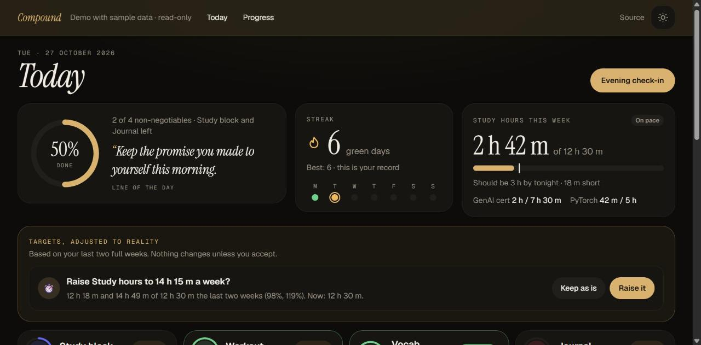
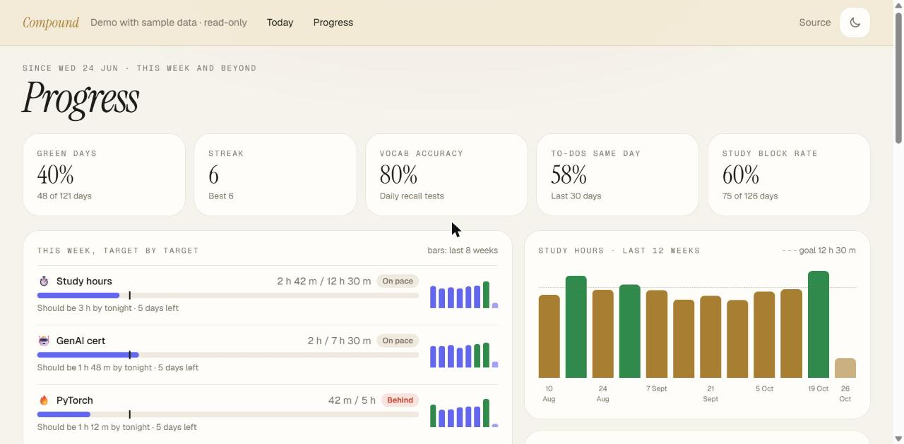
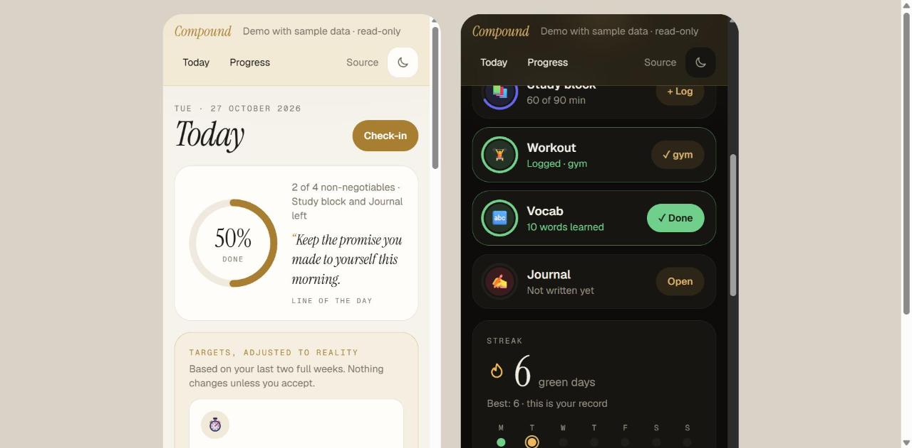
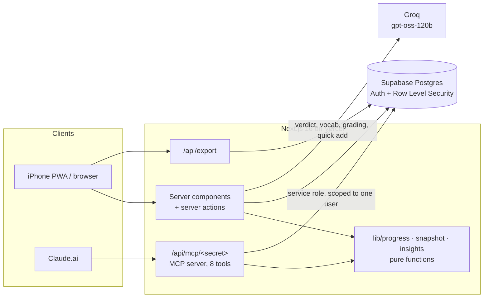

# Compound

**Small daily wins that compound.** A personal tracker I open every evening on my phone to log my day. It tells me honestly where I'm on pace and where I'm behind, adapts my targets to what I actually do, and lets me log by chatting with Claude.

**[Live demo with sample data →](https://compound-gray-pi.vercel.app/demo)** · Next.js 16 · Supabase · Groq · MCP · installable PWA



<table>
  <tr>
    <td></td>
    <td></td>
  </tr>
</table>

## The problem

A spreadsheet tells you totals. It doesn't tell you that it's Thursday, you've done 4 of 10 study hours and you should be at 6. Habit apps count streaks, but they don't know that "study" means 90 minutes on weekdays and 150 at weekends, that a rest day shouldn't break a workout streak, or that a certification exam is in 21 days and needs 43 minutes a day.

Compound models commitments the way they actually work: **daily non-negotiables → weekly targets → dated milestones**, and answers one question every evening: *am I on pace?*

## What it does

- **Pace, not just totals.** Every weekly target shows where you should be by tonight, weighted by the real schedule (weekend study counts more), with an ahead / on pace / behind call.
- **Two-minute evening check-in** ending in an **AI verdict**: a short, honest read on the day from Groq, generated from numbers and checkmarks only.
- **Adaptive targets.** Two full weeks under 60% of a goal suggests lowering it; above 90% suggests raising it. Always a suggestion you accept or dismiss, never automatic, and every change is versioned in `target_history`.
- **Daily vocab.** Groq picks 10 new words a day (5 tech and data, 5 advanced English), never repeating one. The next day you type what each means and Groq grades your answers, with Leitner-box spaced repetition deciding when each word returns.
- **To-dos with accountability.** Natural-language quick add ("renew insurance by friday ~30m" → title, category, due date). Unfinished items carry over with a "Carried 3 days" tag; the finished log records listed → finished dates and tracks your same-day rate.
- **Journal, watchlist, milestones, insights.** One private entry per day (autosaves; never sent to any AI), a watchlist with "I have 30 min and want something fun", milestone checklists measured in hours, an 18-week heatmap and simple correlations (study on workout days vs other days).
- **Log from chat.** An MCP server lets Claude.ai log your day, add to-dos and journal entries, quiz you on vocab and report your week.
- **Yours.** Export everything as JSON or any table as CSV. Light and dark themes. Installs on iPhone as a full-screen app.

## Architecture



- **One source of truth for the maths.** Pace, streaks, rest-day allowances, milestone burn-down, adaptive suggestions and insights are pure TypeScript functions over plain rows (`lib/progress.ts`, `lib/snapshot.ts`, `lib/insights.ts`). The app, the MCP server and the public demo all call the same code; the demo just feeds it generated data (`lib/demo.ts`).
- **Nothing hardcoded.** Areas, targets, milestones, word groups and to-do categories are all database rows. Weekly targets *roll up* daily logs (`rollup_from`) and can filter by tag, so "PyTorch hours" is just "study minutes tagged pytorch". A new commitment is a new row, not new code.
- **Security.** Row Level Security on every table (owner only). The MCP server has no browser session, so it uses the service-role key and filters every query by user id, behind an unguessable URL secret (wrong secret → 404). Keys live only in environment variables.
- **Privacy by design.** The verdict prompt receives checkmarks, numbers and task titles. Journal text never leaves the database; the verdict only sees "journal: done / not done".
- **Next.js 16 specifics.** Cache Components with partial prerendering, `proxy.ts` for auth, server actions with `refresh()` for instant pace updates, optimistic UI for every tap.

## Data model

| Table | Holds |
|---|---|
| `areas` | Life areas and to-do categories (colour, `for_tasks`) |
| `targets` | Daily / weekly / milestone goals with `rollup_from` and a `rules` JSON (weekend minimum, rest days, tags, word groups) |
| `target_history` | Old versions of a target, written by a trigger on every change |
| `daily_logs` | What happened: one row per session or tick, with an optional tag |
| `tasks` | To-dos (`listed_on`, `finished_on`, category) and milestone checklist items |
| `vocab_words`, `vocab_reviews` | Words with Leitner box and next review; every graded answer |
| `journal_entries`, `watchlist`, `verdicts`, `target_suggestions` | Journal (one per day), watchlist, daily AI verdicts with their inputs, accepted / dismissed suggestions |

Schema and RLS policies: [`supabase/migrations`](supabase/migrations).

## Tech

Next.js 16 (App Router, TypeScript, React 19, Turbopack) · Tailwind CSS 4 · Supabase (Postgres, Auth, RLS) · Groq (`openai/gpt-oss-120b`, JSON mode) · MCP via `mcp-handler` · Vercel · PWA manifest and generated icons (`next/og`)

## Run it yourself

1. **Supabase:** create a project, then run the three files in [`supabase/migrations`](supabase/migrations) in order in the SQL Editor.
2. **Login:** Authentication → Users → *Add user* (tick *Auto Confirm User*), then turn off *Allow new users to sign up*.
3. **Keys:** copy `.env.local.example` to `.env.local` and fill it in (Supabase → Project Settings → API; a Groq key from console.groq.com).
4. **Install, seed, run:**

   ```bash
   npm install
   npm run seed
   npm run dev
   ```

### Deploy and install on iPhone

1. Import the repo into Vercel and add the environment variables from `.env.local.example`. Every push to `main` redeploys.
2. In Supabase, set Authentication → URL Configuration → **Site URL** to the Vercel address.
3. On iPhone, open the site in Safari → Share → **Add to Home Screen**.

### Chat logging from Claude.ai (MCP)

1. Add `MCP_SECRET` (long random string), `COMPOUND_USER_ID` (your Supabase user id) and `COMPOUND_TIMEZONE` (e.g. `Asia/Kolkata`) to Vercel and redeploy.
2. Claude.ai → Settings → Connectors → **Add custom connector** → URL `https://<your-app>.vercel.app/api/mcp/<MCP_SECRET>`.
3. Tools: `get_targets`, `log_day`, `add_journal_entry`, `add_task`, `add_watchlist_item`, `get_words`, `get_week_summary`, `update_target`.

The full URL works like a password, so keep it private.

## Project layout

```
app/(app)/          signed-in pages: Today, To-do, Journal, Vocab, Watchlist, Progress, Check-in, Export
app/demo/           public demo (generated data, read-only)
app/api/            MCP server and data export
components/         UI: bento cards, tiles, quick add, charts
lib/                pure logic (progress, snapshot, insights, todo), data loading, Groq, prompts, demo data
proxy.ts            session refresh and login redirect
scripts/            seed data and icon generator
supabase/migrations schema, RLS, triggers
```
